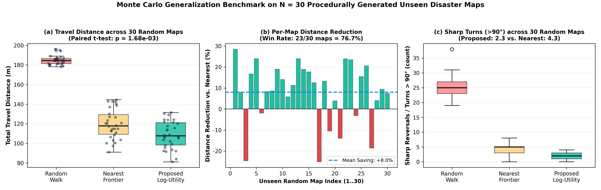

# Autonomous Frontier-Based Exploration for Victim Localization and Evacuation Mapping

[](https://www.python.org/)
[](#)
[-orange.svg)](#)

> **Final Project — Robotics Engineering (DUT)**
> **Topic:** *Application of Frontier-Based Autonomous Exploration for Victim Localization and Evacuation Mapping Using a Rescue Mobile Robot in Collapsed Buildings*
> **Authors:** Le Thanh Duy & Lai Tien Dat — Faculty of Electronics and Artificial Intelligence, University of Science and Technology – The University of Danang (DUT)

---

## 1. Overview & Key Contributions

In GPS-denied collapsed buildings with dense smoke and rubble, classical **Nearest Frontier** exploration (Yamauchi, 1997) suffers from myopic backtracking into tiny 1–2 cell shadow pockets and frequent sharp tracked-chassis reversals ($>90^\circ$).

This project implements a complete closed-loop **Sense – Map – Plan – Act** autonomous rescue exploration framework featuring:
1. **Two-Stage Major Frontier Filtering (`F_major → F_cand`):** Prioritizes large unmapped doorways/chambers ($|F_k| \ge 3$) while automatically falling back to residual pockets for complete coverage ($\ge 98.5\%$).
2. **Multi-Objective Log-Utility Decision Function:** Jointly optimizes logarithmic Information Gain, obstacle-inflated A\* distance, and heading-continuity penalty ($w_I^* = 3.2, w_D = 1.05, w_\theta^* = 8.5$).
3. **Bayesian Log-Odds Smoke-Resistant Mapping:** Rejects up to **30% airborne smoke/dust false reflections** (maintaining **98.6%** coverage & **100.0%** structural accuracy where unfiltered Raw Mapping collapses to **35.7%**).
4. **Multi-Victim Localization & Safety-Inflated A\* Evacuation Routing:** Detects 3/3 victims via Line-of-Sight and automatically computes a safe evacuation corridor with a `0.5 m` rubble clearance buffer.
5. **Monte Carlo Generalization (`N = 30` Unseen Random Maps):** Statistically validated across 30 procedurally generated unseen disaster layouts (**paired *t*-test $p = 0.0017$**, **76.7%** distance win rate, **46.5%** fewer sharp turns $>90^\circ$).



---

## 2. Quantitative Highlights

| Benchmark | Nearest Frontier (Baseline) | Proposed Log-Utility (Ours) | Improvement |
| :--- | :---: | :---: | :---: |
| **Collapsed Building (`Map C`) — Distance** | `116.8 m` | **`80.9 m`** | **`-30.8%`** |
| **Collapsed Building (`Map C`) — Sharp Turns (`>90°`)** | `10 turns` | **`1 turn`** | **`-90.0%`** |
| **Collapsed Building (`Map C`) — 3/3 Victims Found** | `Step 185` | **`Step 87`** | **`53.0% faster`** |
| **30% Dense Smoke + Noise — Coverage** | `35.7%` *(Raw Mapping)* | **`98.6%`** *(Bayesian Log-Odds)* | **`+62.9%`** |
| **Scalability (`2,025 m²`, 25 rooms) — Distance** | `394.5 m` | **`270.3 m`** *(24.6 Hz)* | **`-31.5%`** |
| **Monte Carlo (`30 Random Maps`) — Mean Distance** | `119.5 ± 15.2 m` | **`108.7 ± 14.0 m`** | **`p = 0.0017` (76.7% wins)** |
| **Monte Carlo (`30 Random Maps`) — Sharp Turns** | `4.3 ± 1.9` | **`2.3 ± 1.2`** | **`-46.5%` (86.7% wins)** |

---

## 3. Quick Start & Interactive Live Demo (30 FPS)

### Install Dependencies
```bash
pip install -r requirements.txt
```

### Run the 30 FPS Interactive Live Demo (Supports Map A/B/C/D + Unlimited Random Maps)
On Windows, double-click **`CHAY_DEMO_LIVE.bat`** or run:
```bash
python demo_live_interactive.py
```
**Live Demo Controls:**
- `1` / `2` / `3`: Switch between **3-Algorithm Race**, **2D Detail + 3x Follow-Cam**, and **30% Smoke Test (Raw vs. Bayesian Log-Odds)**
- `N`: Generate a brand-new **Random Disaster Map** on the fly
- `SPACE`: Play / Pause &nbsp;|&nbsp; `R`: Restart &nbsp;|&nbsp; `H`: Hide/Show toolbar &nbsp;|&nbsp; `F11`: Fullscreen &nbsp;|&nbsp; `T`: Thank You screen

### Run Other Scripts & Reproduce Results
```bash
# 1. Run 3D LiDAR Point-Cloud 3-Algorithm Dashboard
python demo_3d_lidar.py --compare --map Map_C

# 2. Run 2D RViz-Style Follow-Cam Simulation
python demo_live.py --map Map_C --strategy utility

# 3. Reproduce Core Multi-Map & Parametric Benchmarks
python rescue_robot_exploration.py

# 4. Reproduce Monte Carlo Generalization Benchmark (30 Unseen Random Maps)
python benchmark_random_maps.py
```

---

## 4. Repository Structure

```text
.
├── CHAY_DEMO_LIVE.bat                                   # 1-Click Windows launcher for 30 FPS Live Demo
├── demo_live_interactive.py                             # 30 FPS OpenCV/Tkinter Live Demo (Map A-D + Random Maps)
├── rescue_robot_exploration.py                          # Core exploration, Bayesian Log-Odds, A*, & benchmarks
├── demo_3d_lidar.py                                     # 3D LiDAR Point-Cloud SLAM & 3-way evaluation dashboard
├── demo_live.py                                         # 2D Matplotlib Follow-Cam simulation visualizer
├── benchmark_random_maps.py                             # Monte Carlo generalization benchmark (N = 30 random maps)
├── simulation_results.json                              # Quantitative benchmark data (Map A-D, Grid Search, Smoke)
├── random_maps_benchmark_30.json                        # Per-map & statistical results for 30 unseen random maps
├── FINAL_REPORT_DUT_ROBOTICS_EN_SUBMISSION_FINAL.pdf    # Complete Final Report (PDF, IEEE & A4 standard)
├── figures/                                             # Publication-ready 300 DPI figures (2D/3D & Monte Carlo)
├── requirements.txt                                     # Python package dependencies
└── README.md
```

---

## 5. Academic Transparency (Inherited Baseline vs. Original Contributions)

| System Module | Inherited Baseline / Reference Source | Original Design & Implementation |
| :--- | :--- | :--- |
| **1. Grid & Path Planning** | 2D grid & priority-queue A\* concept from *PythonRobotics* (A. Sakai). | Single-source multi-target shortest-path tree with **Safety-Inflated A\*** (`w_safe = 2.2`, `0.5 m` clearance). |
| **2. Terrains & LiDAR** | Standard Bayesian Log-Odds formula from *Probabilistic Robotics* (S. Thrun). | 4 3D disaster topologies + procedural **Random Map generator** + asymmetric 30% smoke/noise model. |
| **3. Exploration Strategy** | Classical *Nearest Frontier* baseline by B. Yamauchi (1997). | **Two-Stage Major Frontier Filtering**, **Multi-Objective Log-Utility**, early horizon break, Grid Search, Ablation & **30-Map Monte Carlo**. |
| **4. Rescue & Live Demo** | Not present in baseline path-planning demos. | Line-of-Sight multi-victim localization (`V1–V3`), automated A\* evacuation routing, 3D Point-Cloud SLAM & **30 FPS Live Demo App**. |
